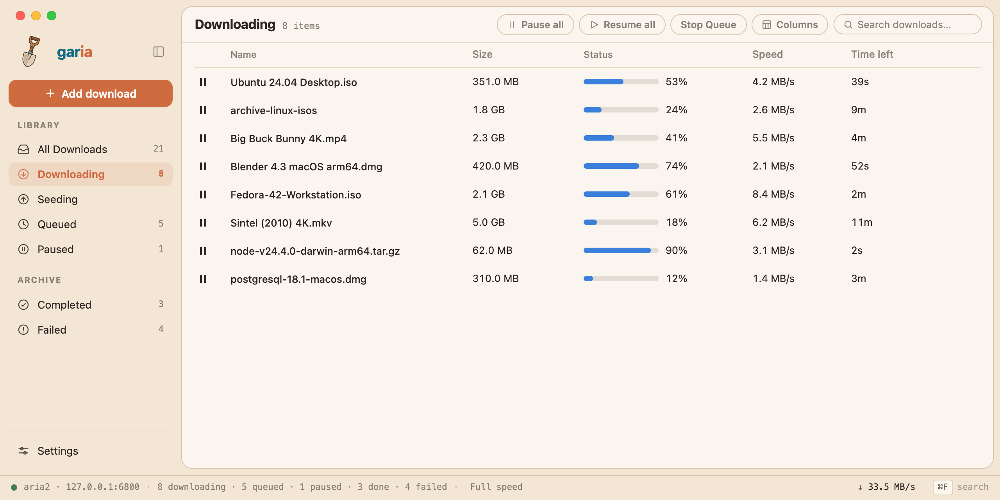

## About

Garia is a fast, easy, and free download manager for macOS and Linux. It is built on [aria2](https://aria2.github.io/) with a native [iced](https://iced.rs/) UI (tiny-skia renderer — no WebView).

Garia manages aria2 automatically — it can ship its own copy beside the app binary and starts it with the app. Closing the window leaves downloads running; Quit is what stops them. You never have to touch the command line to download a file.



It comes as:

 * A native GUI application (Mac + Linux)
 * A browser capture extension for Chrome, Firefox, Edge, Brave, Arc, and Safari
 * Bundled aria2, ffmpeg, and yt-dlp sidecars

This is an **alpha**. Pre-built archives are on the [Releases](https://github.com/fabimc/garia/releases) page. Full DMG / AppImage / `.deb` installers are a packaging follow-up — see [`packaging/`](packaging/).

### macOS

Install with Homebrew from the [personal tap](https://github.com/fabimc/homebrew-garia) after a GitHub Release is published (cask currently expects a DMG — until that lands, use the macOS universal tarball from Releases):

```sh
brew tap fabimc/garia
brew trust fabimc/garia
brew install --cask garia
```

### Linux

Grab the Linux x86_64 tarball from [Releases](https://github.com/fabimc/garia/releases). Prefer installing [`packaging/garia.desktop`](packaging/garia.desktop) if you want `garia://`, magnet, and `.torrent` associations.

Visit https://fabimc.github.io/garia/ for the download, a feature tour, and the FAQ, or https://github.com/fabimc/garia for source, issues, and releases.

## Documentation

[Garia's documentation](docs/README.md) is the place for features, building, the bundled tools, and the browser extension.

## Building

Garia builds with Cargo. No Node/Tauri/WebKit required for the app binary.

For a more detailed description, dependencies, sidecar notes, and the release workflow, visit [Building Garia](docs/Building.md) in docs.

### Requirements (macOS)

| Tool | Version | Install |
|------|---------|---------|
| macOS | 11.0+ | — |
| [Xcode Command Line Tools](https://developer.apple.com/xcode/) | — | `xcode-select --install` |
| [Rust](https://www.rust-lang.org/) | 1.70+ | `brew install rust` |

### Requirements (Linux)

| Tool | Version | Install (Debian/Ubuntu) |
|------|---------|-------------------------|
| Rust | 1.70+ | [rustup](https://rustup.rs/) |
| GTK / tray build deps | — | `libgtk-3-dev libxdo-dev libayatana-appindicator3-dev libssl-dev pkg-config build-essential` |

aria2 and ffmpeg are not on those lists. Garia can build both and place them in `binaries/` — see [Sidecars](docs/Sidecars.md). Video pages also need [yt-dlp](https://github.com/yt-dlp/yt-dlp); `./scripts/sidecar.sh` fetches a copy into `resources/`, and a `yt-dlp` on `PATH` is preferred if you have one. Linux needs a `python3` 3.10+ for the bundled zipapp.

### Building Garia from Git (first time)

```sh
git clone https://github.com/fabimc/garia.git
cd garia
./scripts/sidecar.sh          # optional but recommended — aria2c, ffmpeg, yt-dlp
cargo run -p garia --release
```

The product binary is **`garia`**. Sidecar scripts are no-ops once the binaries exist.

### Building a release binary

```sh
cargo build --release -p garia
# → target/release/garia
```

A release tag builds Mac (universal) and Linux archives on CI (see `.github/workflows/release.yml`). Packaging those into signed DMG / AppImage / `.deb` is documented under [`packaging/`](packaging/).

**URL schemes / file types** (documented for packaging): `garia://`, `magnet:`, `.torrent` — runtime argv ingest already works; OS registration needs the files in `packaging/`.

## Contributing

Bug reports and pull requests are welcome.

 * Check [existing issues](https://github.com/fabimc/garia/issues) before opening a new one.
 * Documentation lives in `docs/`. Fixes and new pages there are as useful as code.
 * The [browser extension store checklist](docs/Publishing-the-Extension.md) is the path to Chrome Web Store and addons.mozilla.org.
 * The website lives in `site/` — plain HTML and CSS, no build step. A push to `master` that touches it deploys it to GitHub Pages through `.github/workflows/pages.yml`.

Garia is [MIT](LICENSE). The copy of aria2 inside the app is GPL-2.0-or-later, ffmpeg is LGPL-2.1, and yt-dlp is Unlicense.
