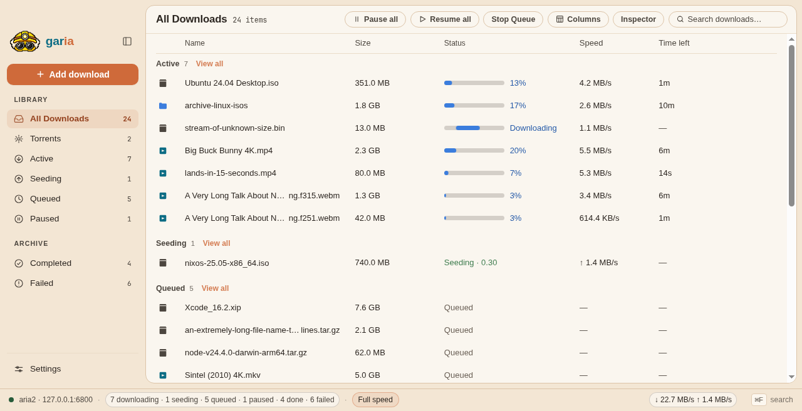

## About

Garia is a fast, easy, and free Linux download manager. It is built on [aria2](https://aria2.github.io/) and wrapped in a [Tauri](https://tauri.app/) native app.

Garia manages aria2 automatically — it ships its own copy inside the app and starts it with the app. Closing the window leaves downloads running; Quit is what stops them. You never have to touch the command line to download a file.



It comes as:

 * A native Linux GUI application (AppImage, `.deb`, and an Arch-compatible tarball)
 * A browser capture extension for Chromium and Firefox
 * Bundled aria2, ffmpeg, and yt-dlp sidecars

This is an **alpha**. Pre-built installers are on the [Releases](https://github.com/fabimc/garia/releases) page.

### Linux

Grab the `.AppImage` (run anywhere) or the `.deb` (Debian/Ubuntu — preferred if you want `garia://`, magnet, and `.torrent` associations) from [Releases](https://github.com/fabimc/garia/releases).

The release also includes `garia-<version>-linux-x86_64.tar.gz`, a portable payload for Arch-based distributions.

On Omarchy, the recommended package will be `garia-bin` from OPR:

```sh
omarchy pkg add garia-bin
```

Until it is available, download the x86_64 AppImage from Releases and run it manually:

```sh
chmod +x Garia_<version>_amd64.AppImage
./Garia_<version>_amd64.AppImage
```

The AppImage is a temporary portable option: it is not managed by pacman and does not register a system menu entry or file and magnet handlers. OPR is the intended Omarchy install path.

For Hyprland dwindle, tile Garia at 660px wide or more. The sidebar collapses to an icon rail and optional list columns compact as the pane narrows; below the minimum width, use a floating window.

Garia advertises light and dark `color-scheme` support and keeps its own palette under the system preference; pixel-perfect matching of every Omarchy theme is a non-goal. Live WebKitGTK toggle-without-relaunch behavior still needs host confirmation.

For Chromium capture on Omarchy, see the [browser extension setup](docs/Browser-Capture.md#omarchy-chromium).

Visit https://fabimc.github.io/garia/ for the download, a feature tour, and the FAQ, or https://github.com/fabimc/garia for source, issues, and releases.

## Documentation

[Garia's documentation](docs/README.md) is the place for features, building, the bundled tools, and the browser extension.

Intent for agents and contributors lives in [`src/md/`](src/md/README.md) ([srcmd.org](https://srcmd.org/) layout). Change that Markdown first, then derive code and tests from it. Formal docs stay in `docs/`.

## Building

Garia builds from the command line with Tauri.

For a more detailed description, dependencies, sidecar notes, signing, and the release workflow, visit [Building Garia](docs/Building.md) in docs.

### Requirements

| Tool | Version | Install (Debian/Ubuntu) |
|------|---------|-------------------------|
| Rust | 1.70+ | [rustup](https://rustup.rs/) |
| Node.js | 18+ | distro package or nvm |
| WebKitGTK / build deps | — | `libwebkit2gtk-4.1-dev libssl-dev libayatana-appindicator3-dev librsvg2-dev patchelf pkg-config build-essential` |

aria2 and ffmpeg are not on those lists. Garia builds both and bundles them — see [Sidecars](docs/Sidecars.md). Video pages also need [yt-dlp](https://github.com/yt-dlp/yt-dlp); a copy is fetched into the bundle, and a `yt-dlp` on `PATH` is preferred if you have one. Linux needs a `python3` 3.10+ for the bundled zipapp.

### Building Garia from Git (first time)

```sh
git clone https://github.com/fabimc/garia.git
cd garia
npm install
npm run tauri dev
```

The first run takes a few minutes while Cargo compiles the Tauri runtime and the sidecar scripts build aria2 and ffmpeg. Subsequent runs are fast — the scripts are no-ops once the binaries exist.

### Building a Garia release from the command line

```sh
npm run tauri build
```

This produces an AppImage and a `.deb` under `src-tauri/target/release/bundle/`.

## Contributing

Bug reports and pull requests are welcome.

 * Check [existing issues](https://github.com/fabimc/garia/issues) before opening a new one.
 * Intent for modules and features lives in `src/md/` ([srcmd.org](https://srcmd.org/)). Curate that first when changing behavior.
 * User-facing documentation lives in `docs/`. Fixes and new pages there are as useful as code.
 * The [browser extension store checklist](docs/Publishing-the-Extension.md) is the path to Chrome Web Store and addons.mozilla.org.
 * The website lives in `site/` — plain HTML and CSS, no build step. A push to `master` that touches it deploys it to GitHub Pages through `.github/workflows/pages.yml`.

Garia is [MIT](LICENSE). The copy of aria2 inside the app is GPL-2.0-or-later, ffmpeg is LGPL-2.1, and yt-dlp is Unlicense.
